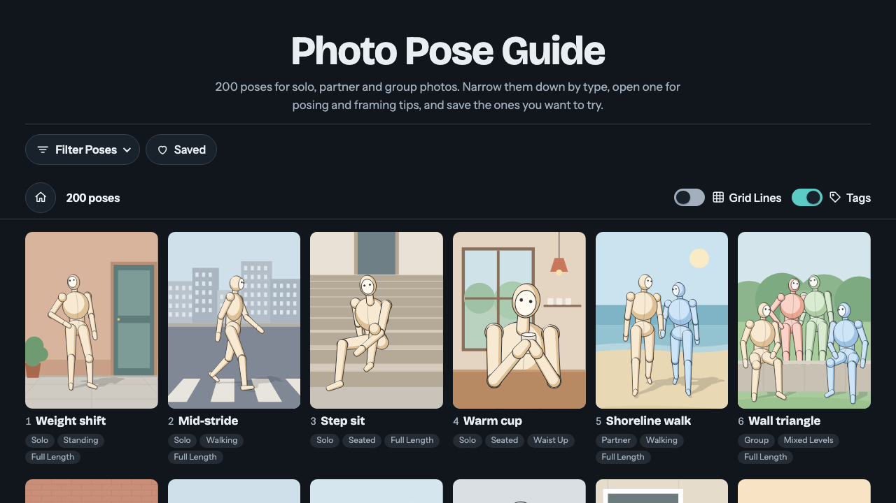

# Photo Pose Guide

https://campasachamp.github.io/pose-guide/

<p align="center">
  <a href="https://campasachamp.github.io/pose-guide/">
    
  </a>
</p>

200 illustrated photo poses for solo, partner and group shots. Each pose has a posing tip and a framing tip, and can be filtered by people, pose type, shot, setting and camera angle.

The whole site is one file, `index.html`. Visitors need nothing else: no build step and no install.

`index.html` is generated. To add or change poses, edit the Python in `generator/` and rebuild. See `generator/README.md`.

## Put it online with GitHub Pages

1. Create a new public repository on GitHub.
2. Upload `index.html` (and this README) to the root of the repository.
3. In the repository, open **Settings**, then **Pages**.
4. Under **Build and deployment**, set **Source** to "Deploy from a branch", choose the `main` branch and the `/ (root)` folder, and save.
5. After a minute or so the site is live at `https://campasachamp.github.io/pose-guide/`.

You can also open `index.html` straight from your computer to preview it.

## How it works

- All 200 illustrations are stored inside the file as vector drawings, so they stay sharp at any size.
- Thumbnails are only drawn while they are near the visible part of the page.
- Each pose has its own address, for example `.../#pose-49`, so a single pose can be linked or bookmarked.
- "Save Pose" keeps a shortlist in the visitor's own browser. It is not shared between people or devices.
- The two typefaces load from Google Fonts. Without a connection the page falls back to system fonts.

## Updating the screenshot

The image at the top of this page, `docs/screenshot.png`, is made by [readme-screenshot](https://github.com/CampAsAChamp/readme-screenshot) from `.readme-screenshot.yml`. It serves `index.html` locally and captures it in headless Chromium.

- **Automatically:** the `Screenshot` workflow (`.github/workflows/screenshot.yml`) runs when `index.html` or the config changes on `main`, and commits the image if it differs. You can also run it by hand from the Actions tab.
- **Locally:** you need Node 22 or later.

  ```bash
  npm install -g github:CampAsAChamp/readme-screenshot#v1.1.4
  npx playwright install chromium
  readme-screenshot capture
  ```

The page has a single dark theme, so the capture is one image with no light/dark blend.
